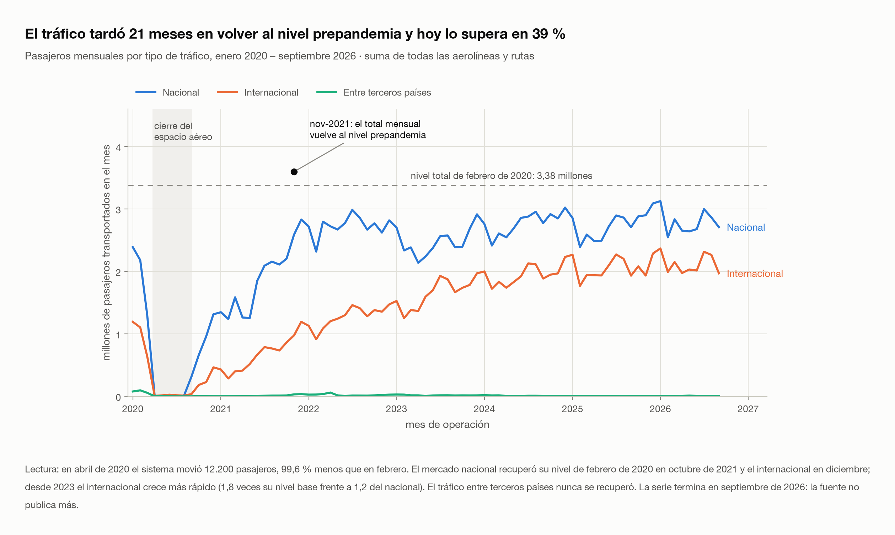
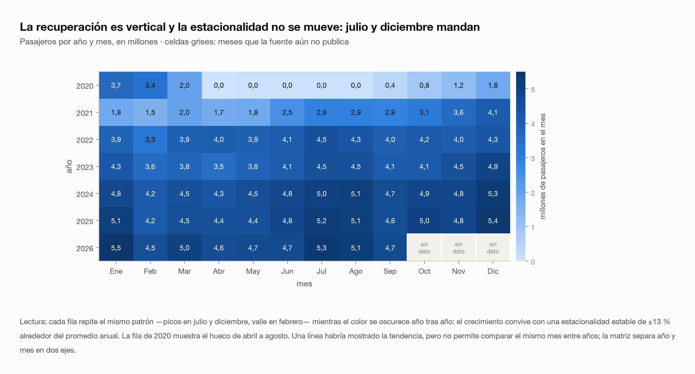
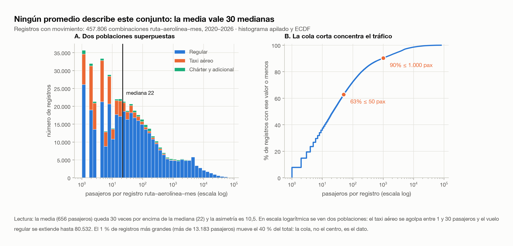
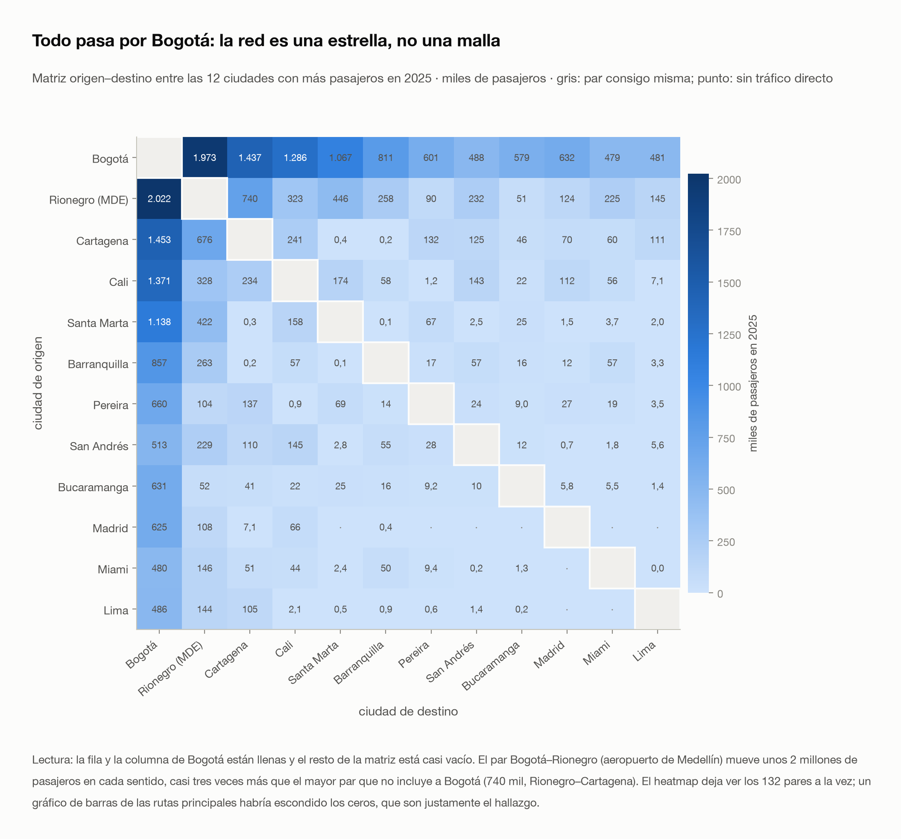
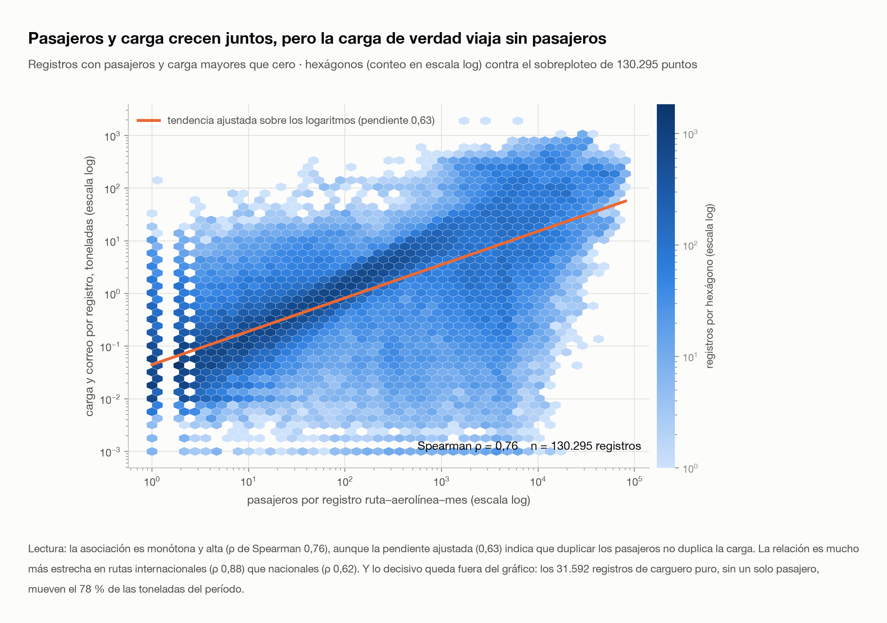

# El tráfico aéreo comercial de Colombia, 2020–2026

Análisis exploratorio de datos del registro de **tráfico origen–destino** de la Aeronáutica Civil de
Colombia: 501.819 filas, 16 columnas, 81 meses, 165 aerolíneas y 14.133 rutas.

**Autora:** Marcela Heredia · **Entregable:** cuaderno ejecutado + figuras + este README.

---

## De qué trata el conjunto y de dónde sale

| | |
|---|---|
| **Fuente** | Aeronáutica Civil de Colombia — *Transporte Aéreo Comercial · Tráfico Origen‑Destino* |
| **Portal** | [datos.gov.co, conjunto `gb6w-ynu4`](https://www.datos.gov.co/d/gb6w-ynu4) |
| **Licencia** | Creative Commons Attribution Share-Alike 4.0 International (CC BY‑SA 4.0) |
| **Descarga** | 23 de noviembre de 2026 · 501.819 filas × 16 columnas · 61 MB |
| **Unidad de observación** | un registro = aerolínea × ruta × mes × tipo de tráfico × tipo de vuelo |
| **Período** | enero de 2020 – septiembre de 2026 |

Cada fila dice cuántos **pasajeros** y cuántos **kilos de carga y correo** movió una aerolínea entre dos
aeropuertos en un mes. El conjunto llega **sin depurar**: faltantes, duplicados exactos, tipos mal inferidos,
categorías escritas de varias formas y filas sin movimiento. Todo eso se diagnostica y se corrige con
`pandas` en la sección 3 del cuaderno.

## Las tres preguntas

1. ¿Cuánto tardó el tráfico aéreo colombiano en recuperar su nivel prepandemia, y se recuperaron igual el
   mercado nacional y el internacional?
2. ¿Cómo se reparte el tráfico entre rutas, aerolíneas y tipos de vuelo: es un sistema homogéneo o unos
   pocos actores concentran todo?
3. ¿Pasajeros y carga son el mismo negocio?

## Las figuras principales

### La recuperación tomó 21 meses

De 3,38 millones de pasajeros en febrero de 2020 a 12.200 en abril —una caída del 99,6 %—; el total mensual
solo volvió al nivel de partida en noviembre de 2021, y hoy lo supera en 39 %.

### Y la estacionalidad nunca se movió

El color se oscurece año tras año, pero el patrón dentro de cada fila es el mismo: julio y diciembre arriba,
febrero abajo, con una oscilación estable de ±13 % alrededor del promedio anual.

### Un archivo, dos negocios

La media (656 pasajeros por registro) vale 30 medianas: el archivo mezcla vuelo regular con taxi aéreo, y el
1 % de registros más grandes mueve el 40 % de los pasajeros.

### La red es una estrella centrada en Bogotá

La fila y la columna de Bogotá están llenas; la mayoría de los pares entre ciudades grandes que no incluyen a
Bogotá simplemente no tienen vuelo directo.

### La carga de verdad viaja sin pasajeros

Donde conviven se acompañan (ρ de Spearman = 0,76), pero el 78 % de las toneladas lo mueven 31.592 registros
que no llevan un solo pasajero.

> Las nueve figuras, con su lectura completa, están en [`figuras/`](figuras) y dentro del cuaderno.

## Cómo reproducir el análisis desde cero

Los datos **no están en el repositorio** (el archivo crudo pesa 61 MB): se descargan
con un comando desde el portal oficial.

```bash
git clone https://github.com/<usuaria>/EDA_trafico_aereo_colombia.git
cd EDA_trafico_aereo_colombia
pip install -r requirements.txt
python scripts/01_descargar_datos.py
jupyter lab notebooks/analisis_exploratorio.ipynb
```

El tercer comando trae las 501.819 filas desde `datos.gov.co` y las guarda en
`datos/crudos/`. El cuaderno corre de principio a fin sin intervención (unos
20 segundos): lee el CSV crudo, aplica la limpieza, guarda el conjunto depurado en
`datos/procesados/` y regenera las nueve figuras de `figuras/`.

Para leer el informe sin instalar nada basta abrir `notebooks/analisis_exploratorio.html`
en cualquier navegador; esa versión se regenera con `python scripts/03_estilizar_html.py`
y lleva la misma paleta y tipografía de las figuras.

## Estructura

```
EDA_trafico_aereo_colombia/
├── datos/crudos/        archivo descargado (no se versiona: lo baja el script)
├── datos/procesados/    conjunto limpio en parquet (lo genera el cuaderno)
├── scripts/
│   ├── 01_descargar_datos.py   descarga reproducible desde datos.gov.co
│   ├── estilo_viz.py           paleta, estilo de matplotlib y rótulos de figura
│   ├── construir_cuaderno.py   genera el cuaderno a partir de las celdas fuente
│   ├── 02_analisis_completo.py versión .py del cuaderno (exportada con nbconvert)
│   └── 03_estilizar_html.py    exporta el cuaderno a HTML con el diseño del informe
├── notebooks/           cuaderno ejecutado (.ipynb) y su versión HTML
├── figuras/             nueve figuras en PNG a 200 ppp
├── requirements.txt
└── README.md
```

## Nota sobre herramientas de IA

El uso de inteligencia artificial está declarado en la sección 11 del cuaderno. Ninguna cifra fue generada,
imputada ni modificada por IA: todas provienen del archivo de `datos.gov.co` y de las transformaciones
documentadas en el cuaderno.
